# QA Midterm — Mobile Apps: Multiplayer username validation

Delivery index for the Quality Assurance project on
[gabrielhuav/PolitecnicoOpenWorld](https://github.com/gabrielhuav/PolitecnicoOpenWorld).
This document and the `docs/` folder live only on the academic branch `qa/entrega` of my fork;
they are not part of the game code or the Pull Request.

## 1. Student

| Member | GitHub user | Group |
|---|---|---|
| Diego Raymundo Hernández Alonso | [@DiegoRHA030427](https://github.com/DiegoRHA030427) | 7CV4 |

## 2. Goal

Make the Multiplayer username safe end to end. The name typed in the *Connect to Server*
dialog is drawn above the player sprite on **other players'** screens, so an unbounded or
malformed name covers their HUD and controls.

- **v1 (first review):** cap the username at **16 characters** in the dialog.
- **v2 (after the professor's feedback):** turn the cap into a complete validation of the
  name (length, allowed characters, pasted text, old saved names), show it in the dialog,
  apply the same limit to the names received from other players, and cover the rules with
  unit tests.

## 3. Scope

**In scope**

- New pure rules class `PlayerNameRules` (`shared/commonMain`) + `PlayerNameRulesTest` (20 cases).
- *Connect to Server* dialog (`MainMenuScreen.kt`):
  - typed or pasted text is normalized: no line breaks/tabs, no leading or double spaces, max 16;
  - live `x/16` counter;
  - inline error for names shorter than 3 characters or with characters other than
    letters (accents included), digits, space and `_ - .`;
  - *Connect* is disabled while the name is invalid;
  - a name saved by an older version is normalized when the dialog is prefilled.
- The `Jugador_XXXX` fallback name is kept when the field is left blank.
- Remote players' names (`WorldMapMultiplayer.kt`) are capped at 16 with `…` before being drawn
  (protects against older clients that never had the limit).

**Out of scope**

- Name color / font customization (would require a new field in the network protocol and a
  server redeploy before it could be observed in-game).
- Duplicate-name detection.
- Changes to the multiplayer servers (`Multiplayer/`, `MultiplayerInteriores/`, `MultiplayerSF/`).

## 4. Traceability links

| Item | Link / value |
|---|---|
| Issue | [DiegoRHA030427/PolitecnicoOpenWorldExam1#1](https://github.com/DiegoRHA030427/PolitecnicoOpenWorldExam1/issues/1) |
| Pull Request | [gabrielhuav/PolitecnicoOpenWorld#167](https://github.com/gabrielhuav/PolitecnicoOpenWorld/pull/167) |
| Change branch | `fix/limit-multiplayer-username` |
| Base SHA (v1) | [`7ed325393f82872c2be94ff2ada46948efa19152`](https://github.com/gabrielhuav/PolitecnicoOpenWorld/commit/7ed325393f82872c2be94ff2ada46948efa19152) |
| Base SHA (v2, `main` merged into the branch) | [`f34b7ae4aa1e0bad170dafa76be35f0652b6f0cb`](https://github.com/gabrielhuav/PolitecnicoOpenWorld/commit/f34b7ae4aa1e0bad170dafa76be35f0652b6f0cb) |
| **Final delivered SHA** | [`3207af6bb68f80d850191d7369765edc891c012c`](https://github.com/DiegoRHA030427/PolitecnicoOpenWorldExam1/commit/3207af6bb68f80d850191d7369765edc891c012c) |
| App version | `1.0.0.18` |

### 4.1 Commits in the PR

| SHA | Commit | Files |
|---|---|---|
| `fbcd55cd` | fix: limit username to 16 characters *(v1)* | `MainMenuScreen.kt` |
| `35bb1aef` | Merge upstream/main into fix/limit-multiplayer-username | — (sync, no conflicts) |
| `8bc78e5a` | feat: add PlayerNameRules for multiplayer username validation | `PlayerNameRules.kt`, `PlayerNameRulesTest.kt` |
| `6116d70d` | feat: validate username in the Connect to Server dialog | `MainMenuScreen.kt`, `strings.xml` (es / en) |
| `3207af6b` | fix: cap remote player names before drawing them on the map | `WorldMapMultiplayer.kt` |

Before starting v2, the 14 open PRs of the upstream repository were reviewed: none of them
modifies `MainMenuScreen.kt`, `WorldMapMultiplayer.kt` or the
`shared` `composeResources` strings, so the PR does not collide with other open PRs.

## 5. Test environment

| Item | Value |
|---|---|
| OS | Windows |
| IDE | Android Studio Quail 3 (2026.1.3), bundled JBR |
| Build | Gradle wrapper 9.5.0 · AGP 9.3.0 · Kotlin 2.3.21 · Java target 11 |
| Android SDK | compileSdk 36 · targetSdk 36 · minSdk 24 |
| Devices | Emulator *Medium Phone*, Android 17 (API 37), x86_64 · Physical Android phone (v1) |
| Setup | Only the internal `PolitecnicoOpenWorld` folder opened in Android Studio; fictitious usernames only; `local.properties` not committed |

## 6. Test matrix

v1 matrix with steps, expected/actual results and evidence: **[docs/pruebas.md](docs/pruebas.md)**

| Case | Type | Covers | Version | Status |
|---|---|---|---|---|
| CP-01 | Happy path | AC1, R1 | v1 | ✅ Passed |
| CP-02 | Boundary (16 chars) | AC2, R2 | v1 | ✅ Passed |
| CP-03 | Regression (blank-name fallback) | R3 | v1 | ✅ Passed |
| CP-04 | Navigation / state (Back, rotation) | — | v1 | ✅ Passed |
| CP-05 | Accessibility (max font size) | R4 | v1 | ✅ Passed |
| CP-06 | Compatibility (emulator vs phone) | — | v1 | ✅ Passed |
| CP-07 | Happy path: counter `12/16` with a valid saved name, *Connect* enabled | AC3 | v2 | ✅ Passed |
| CP-08 | Boundary: `Jug` (3) is valid; `Ju` (2) shows *At least 3 characters* and disables *Connect* | AC4 | v2 | ✅ Passed |
| CP-09 | Alternate: emoji in the name shows *Only letters, numbers, spaces and _ - .* and disables *Connect* | AC5 | v2 | ✅ Passed |
| CP-10 | Regression: empty field shows `0/16`, *Connect* stays enabled, `Jugador_6765` is generated, saved and prefilled next time | R3 | v2 | ✅ Passed |
| CP-11 | Regression: multiplayer session still connects after the change (Logcat) | R5 | v2 | ✅ Passed |
| CP-12 | Unit tests: `PlayerNameRulesTest` (20 cases) | R1, R2 | v2 | ✅ Passed |

**v2 test cases (detail)**

| ID | Steps | Expected | Actual | Evidence |
|---|---|---|---|---|
| CP-07 | 1. Main menu → *Multiplayer*. 2. Wait for the server warm-up. 3. Observe the prefilled field. | Saved name shown with `12/16` counter; *Connect* enabled. | As expected. | [v2_01](docs/evidencias/v2_01_contador.png) |
| CP-08 | 1. In the dialog, delete characters until `Jug`. 2. Delete one more (`Ju`). | `Jug` → `3/16`, no error. `Ju` → red field, *At least 3 characters*, *Connect* greyed out. | As expected. | [v2_02](docs/evidencias/v2_02_muy_corto.png) |
| CP-09 | 1. With `Ju`, insert an emoji from the keyboard. | Red field, *Only letters, numbers, spaces and _ - .*, *Connect* greyed out. | As expected. | [v2_03](docs/evidencias/v2_03_caracter_invalido.png) |
| CP-10 | 1. Delete everything. 2. Tap *Connect*. 3. Back to the menu → *Multiplayer* again. | Empty field shows `0/16` and *Connect* enabled; a `Jugador_XXXX` name is generated and prefilled the next time. | `Jugador_6765` generated and prefilled (`12/16`). | [v2_04](docs/evidencias/v2_04_vacio_respaldo.png), [v2_05](docs/evidencias/v2_05_respaldo_guardado.png) |
| CP-11 | 1. Connect with the fallback name. 2. Check Logcat (`package:mine`). | Client joins the session. | `Multiplayer: Mi rol en esta zona ahora es Host: true`. The map stays on *Loading streets 25%* because `overpass-api.de` timed out (external service, also unrelated to the name). | [v2_06](docs/evidencias/v2_06_logcat_conectado.jpg) |
| CP-12 | 1. Run `PlayerNameRulesTest` on the JVM. 2. Run `.\gradlew.bat :shared:testAndroidHostTest`. | All green. | 20/20 passed; BUILD SUCCESSFUL. | Section 8 |

## 7. Evidence

### 7.1 v1 — *Connect to Server* dialog

| Before (base SHA `7ed32539`) | After v1 (`fbcd55cd`) |
|---|---|
| 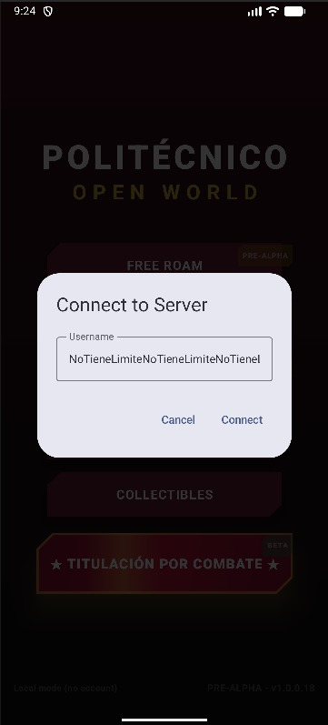 | 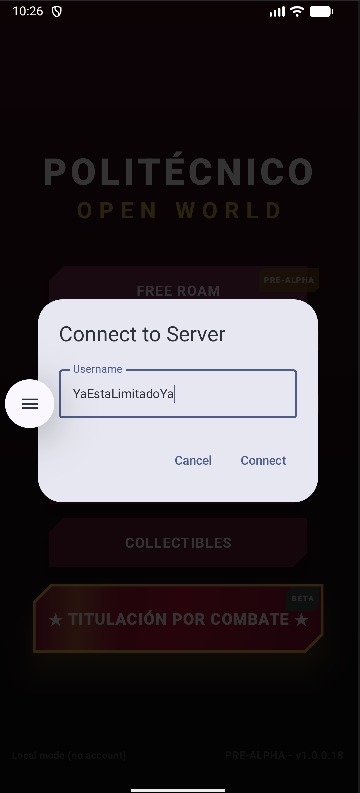 |
| The field accepts a name with no limit (`NoTieneLimiteNoTieneLimiteNoTiene…`). | The field stops at 16 characters (`YaEstaLimitadoYa`). |

### 7.2 v1 — Name label on the map (seen by another player)

**Before:** the unlimited name is drawn as a strip across the whole screen,
on top of the controls and the HUD.

| Capture 1 | Capture 2 | Capture 3 |
|---|---|---|
| 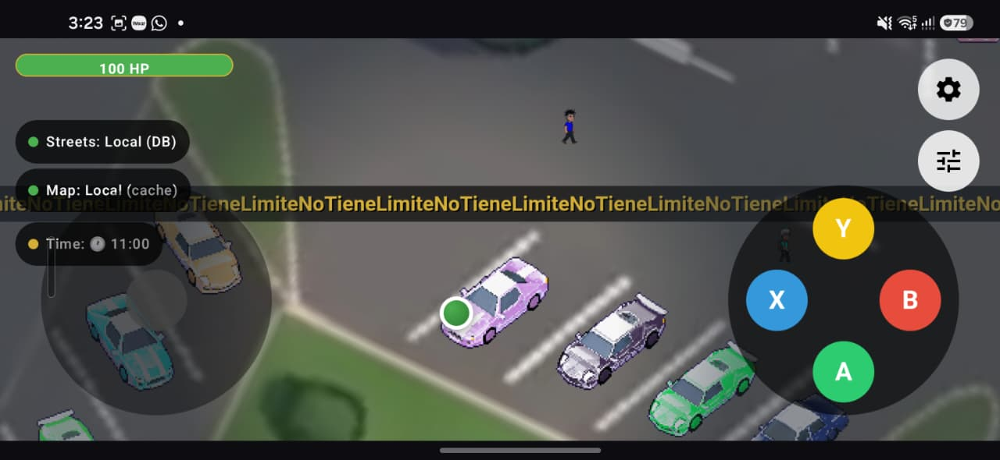 | 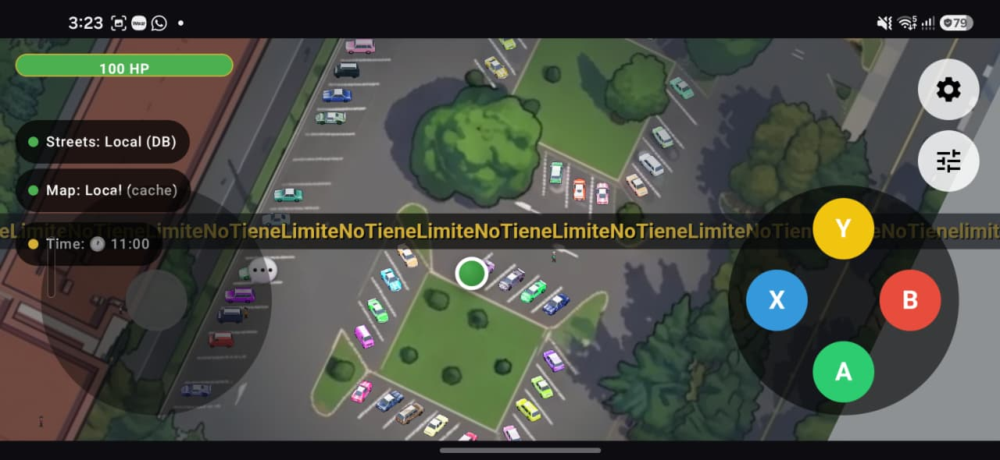 | 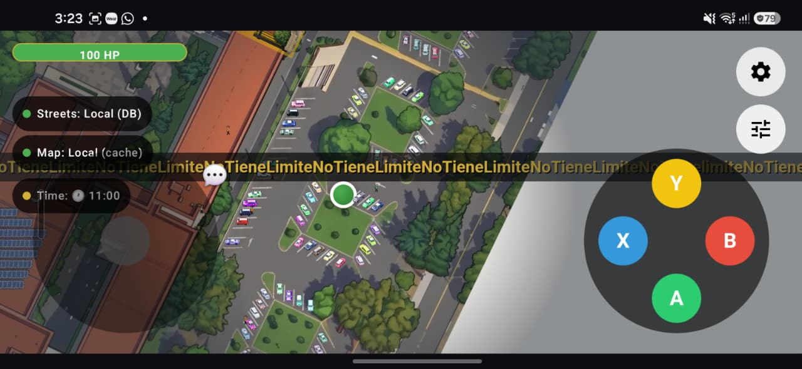 |

**After:** the label takes a bounded space next to the player.

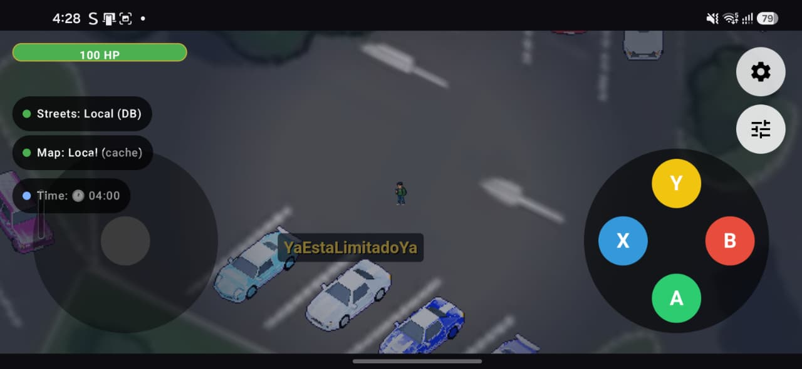

### 7.3 v2 — Validation in the dialog (final SHA)

Before v2 the dialog had no counter, no error message and *Connect* was always enabled
(see *After v1* in 7.1): any symbol, emoji or a one-letter name was accepted.

| CP-07 · Counter | CP-08 · Too short |
|---|---|
| 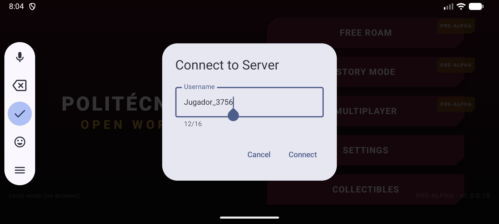 | 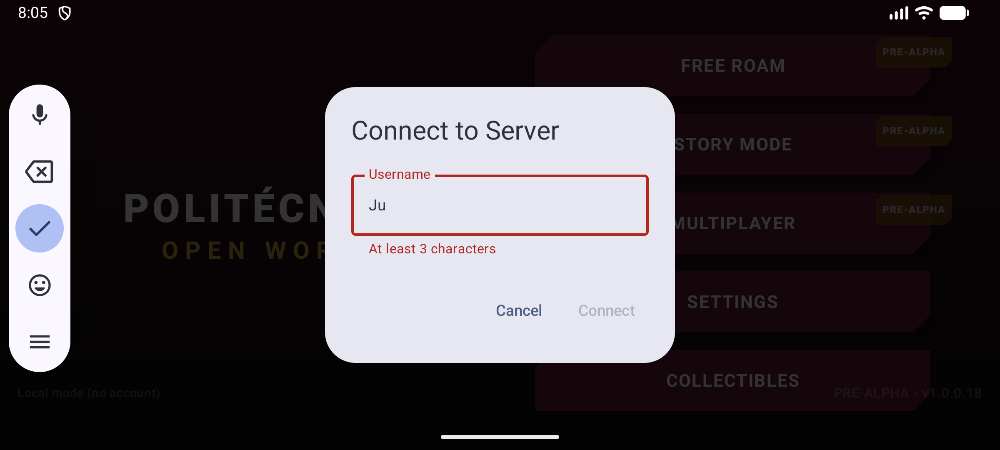 |
| Valid saved name: `12/16`, *Connect* enabled. | `Ju`: *At least 3 characters*, *Connect* disabled. |

| CP-09 · Invalid character | CP-10 · Empty field |
|---|---|
|  | 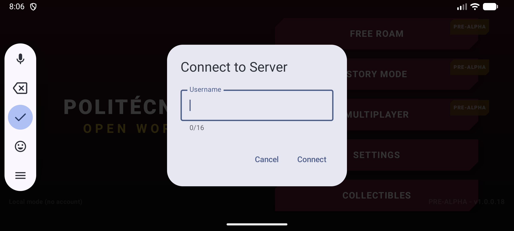 |
| Emoji: *Only letters, numbers, spaces and _ - .*, *Connect* disabled. | Empty: `0/16`, *Connect* enabled (fallback name). |

| CP-10 · Fallback saved | CP-11 · Session still connects |
|---|---|
| 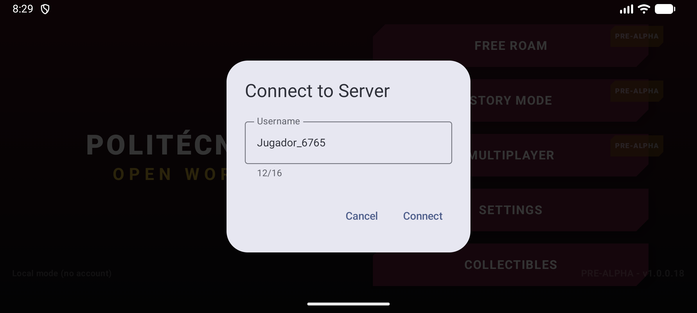 | 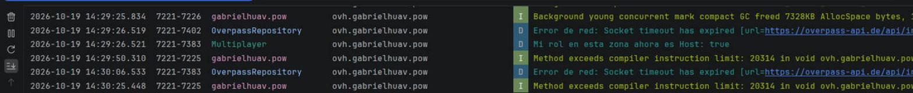 |
| `Jugador_6765` was generated, saved and prefilled. | Logcat confirms the multiplayer session after connecting. |

## 8. Automated checks

| Check | What it verifies | SHA | Status | Log |
|---|---|---|---|---|
| Android Studio build + install | App compiles (`:app` + `:shared`) and installs on the emulator | `3207af6b` | ✅ *Gradle build finished in 3 m 4 s* · *Install successfully finished* | — |
| `PlayerNameRulesTest` (JVM, JUnit 4) | Sanitizing, 16-char cap, min length, allowed characters, fallback, remote names with `…` | `8bc78e5a` | ✅ 20 / 20 passed | — |
| detekt 1.23.8 (project config) | Static analysis on the changed Kotlin files | `3207af6b` | ✅ 0 issues | — |
| Local Gradle run (Windows, Gradle wrapper) | `.\gradlew.bat :app:assembleDebug :app:testDebugUnitTest` and `.\gradlew.bat :shared:testAndroidHostTest` | `3207af6b` | ✅ BUILD SUCCESSFUL (both runs) | — |

## 9. Peer review

| Role | Link | Status |
|---|---|---|
| Review received on my PR | [PR #167](https://github.com/gabrielhuav/PolitecnicoOpenWorld/pull/167) | By Julio Reyes Olascoaga |
| Review I gave to a classmate | [PR #156](https://github.com/gabrielhuav/PolitecnicoOpenWorld/pull/156) | Done |

## 10. Conclusions

- v1 met its two acceptance criteria (valid names kept, input stops at 16).
- v2 closes the two risks left open by v1 (*pasted text* and *old saved names*), validates
  length and allowed characters in the dialog, and also caps the names received from other
  players before drawing them.
- 12 of 12 test cases passed (6 from v1, 6 from v2); no defects found within scope.
- **Recommendation:** merge.
- **Remaining risks:**
  - Two-letter names are no longer accepted (minimum 3).
  - The multiplayer servers still relay the name as sent; protection is on the client side.
  - Map loading depends on `overpass-api.de`; it timed out during this session (unrelated to the change).

## 11. Individual log

[docs/bitacora.md](docs/bitacora.md)

## 12. References

- [Upstream repository: gabrielhuav/PolitecnicoOpenWorld](https://github.com/gabrielhuav/PolitecnicoOpenWorld)
- [Working fork: DiegoRHA030427/PolitecnicoOpenWorldExam1](https://github.com/DiegoRHA030427/PolitecnicoOpenWorldExam1)
- [Material 3 — Text fields: supporting text and error state](https://m3.material.io/components/text-fields/guidelines)
